# Qué pagos revisar

**Un modelo para ordenar la cola diaria de revisión manual de pagos con tarjeta, evaluado con el mismo cupo de
60 revisiones por día en dos meses reservados**

Proyecto final · Minería de Datos · ITAM · noviembre de 2026 · Datos públicos: IEEE-CIS Fraud Detection
(Vesta), copia OpenML 46858

## Resumen ejecutivo

**La decisión.** Un procesador de pagos de comercio electrónico autoriza miles de pagos con tarjeta al día. Al
cierre de cada día, su equipo de riesgo puede enviar 60 de esos pagos a revisión manual, cerca de 2% del total.
Un fraude revisado se detiene antes de que llegue el contracargo; un fraude no revisado se pierde completo. La
pregunta es **qué 60 pagos revisar cada día** para que la cola contenga la mayor cantidad posible de fraude en
dólares.

**Qué se hizo.** Con los 590,540 pagos públicos de la competencia IEEE-CIS (182 días, en orden temporal) se
construyó un modelo que ordena los pagos de cada día por fraude esperado: probabilidad estimada × monto. Las
variables usan solo información disponible antes de cada pago: el pago mismo y el historial de cinco llaves
(cuatro de tarjeta y un cliente reconstruido). En los días 61 a 120 compitieron 31 combinaciones de política y
conjunto de variables, todas con el mismo cupo:

- seis reglas de tasa histórica × monto, que representan la práctica actual;
- una logística regularizada, con cinco valores de penalización y dos conjuntos de variables;
- seis modelos flexibles (árbol, bosque, XGBoost, XGBoost ponderado, red, ensamble) y un bosque de aislamiento.

La regla de selección se escribió antes del torneo. El modelo elegido (XGBoost sobre el conjunto F3), los
comparadores, las hipótesis y las huellas SHA-256 del código se congelaron antes de leer cualquier pago del día
121 en adelante. La prueba se corrió una sola vez.

**El resultado.** Miles de dólares de fraude dentro de la cola, con 60 revisiones por día:

| | Días 121–151 (P1) | Días 152–182 (P2) |
|---|---:|---:|
| Pagos / revisiones | 86,672 / 1,860 | 89,326 / 1,860 |
| Fraude del mes | 472.7 | 477.4 |
| Mayor monto primero | 131.2 | 120.9 |
| Mismo modelo ordenado solo por probabilidad (enfoque de la competencia) | 100.6 | 129.9 |
| Mejor regla: tasa por segmento × monto | 162.6 | 138.7 |
| Mejor logística (C = 0.003, F3) | 186.9 | 185.5 |
| **XGBoost F3 congelado** | **211.4** | **226.7** |
| Oráculo que conoce las etiquetas (techo) | 432.5 | 438.6 |
| Contra la mejor regla, IC 95% pareado | **+48.9 (+30.1%)**, [+16.8%, +49.8%] | **+88.0 (+63.4%)**, [+39.7%, +97.0%] |
| Contra la mejor logística | +24.6 (+13.1%), [+7.0%, +21.8%] | +41.1 (+22.2%), [+8.7%, +39.3%] |
| Contra ordenar solo por probabilidad | +110.8 (+110.1%), [+76.9%, +147.4%] | +96.8 (+74.5%), [+54.7%, +98.3%] |

**Veredicto contra el protocolo.** Las tres hipótesis fijadas antes de la prueba se cumplen en los dos meses:

- **H1**, ventaja de al menos 20% sobre la mejor regla con límite inferior positivo: +30.1% y +63.4%.
- **H2**, ventaja de al menos 10% sobre la mejor logística con límite inferior positivo: +13.1% y +22.2%.
- **H3**, ventaja sobre ordenar por probabilidad con límite inferior positivo: +110.1% y +74.5%.

En los dos meses, el modelo lleva a la cola 137 mil dólares más que la mejor regla con el mismo número de
revisiones. Gana a la regla en 54 de 62 días y a la logística en 48.

**Qué se puede afirmar.**

- Con un cupo fijo, ordenar por probabilidad × monto con XGBoost lleva más fraude en dólares a la cola que la
  mejor regla y que una logística con la misma información, en dos meses que no se usaron para ninguna decisión.
- La ventaja no depende de unos pocos pagos grandes: sin los pagos sobre el percentil 99, con el monto topado y
  con la mitad o el doble del cupo, nunca baja de 20% contra la regla ni de 8.8% contra la logística.
- Si cada revisión tiene un costo, el modelo deja más beneficio neto que la regla y que la logística en los 14
  escenarios evaluados (siete costos por revisión y dos supuestos de recuperación).
- Ordenar solo por probabilidad, como premiaba la competencia (AUC), tiene mejores métricas de clasificación y
  lleva entre 43% y 52% menos dinero a la cola.

**Qué no se puede afirmar.** El dinero medido es fraude etiquetado que entra a la cola, no efectivo recuperado. La
práctica real de Vesta no es pública; la representa la mejor de seis reglas. La etiqueta de Vesta se propaga a
los pagos posteriores de una cuenta con contracargo, de modo que parte del acierto proviene de reconocer cuentas
ya marcadas.

**Mantenimiento.** Después de la prueba se buscó, con validación cruzada temporal y un diseño registrado antes,
si mejores variables agregaban dinero. Tres grupos nuevos subieron 6.1% en las ventanas de búsqueda, pero en los
días de confirmación, que la búsqueda no usó, el modelo con esas variables llevó 5.3% menos que F3. F3 se
mantiene y el veredicto no cambia (sección 6).

**Recomendación.** Ordenar la cola con el modelo y medir el efectivo recuperado con un piloto de un mes que
asigne días al azar a la cola actual o a la del modelo.

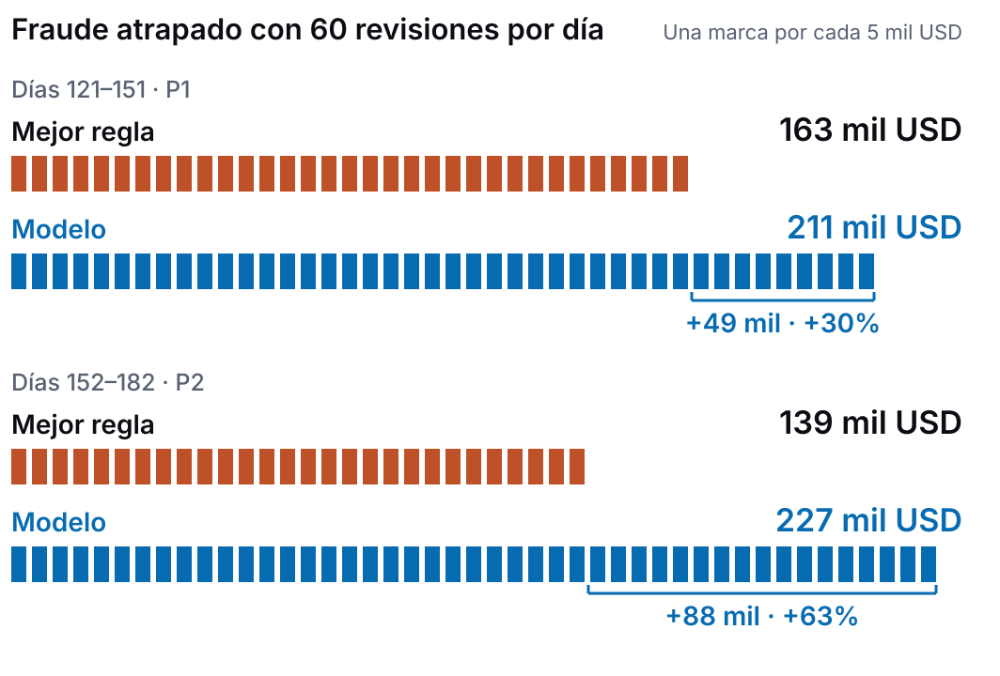
*Figura 1. Fraude en la cola por mes de prueba: mejor regla contra modelo. Cada marca equivale a 5 mil USD.*

## 1. Comprensión del negocio

### 1.1 La decisión

| Elemento | Definición |
|---|---|
| Quién decide | El equipo de riesgo de un procesador de pagos de comercio electrónico (Vesta) |
| Cuándo | Al cierre de cada día, sobre los pagos ya autorizados, con la información disponible hasta ese momento |
| Opciones | Mandar el pago a revisión manual o dejarlo pasar |
| Recurso | 60 revisiones por día, cerca de 2% de los pagos, iguales para todas las políticas |
| Dinero | Dólares (`TransactionAmt`) de los pagos etiquetados como fraude que entran a la cola |
| Práctica actual | Vesta no la publica; la representa la mejor regla del periodo de desarrollo |

El cupo hace que la decisión sea un problema de orden: cada día se elige qué pagos ocupan los 60 lugares. El
umbral de probabilidad no se fija de antemano; lo determina el cupo.

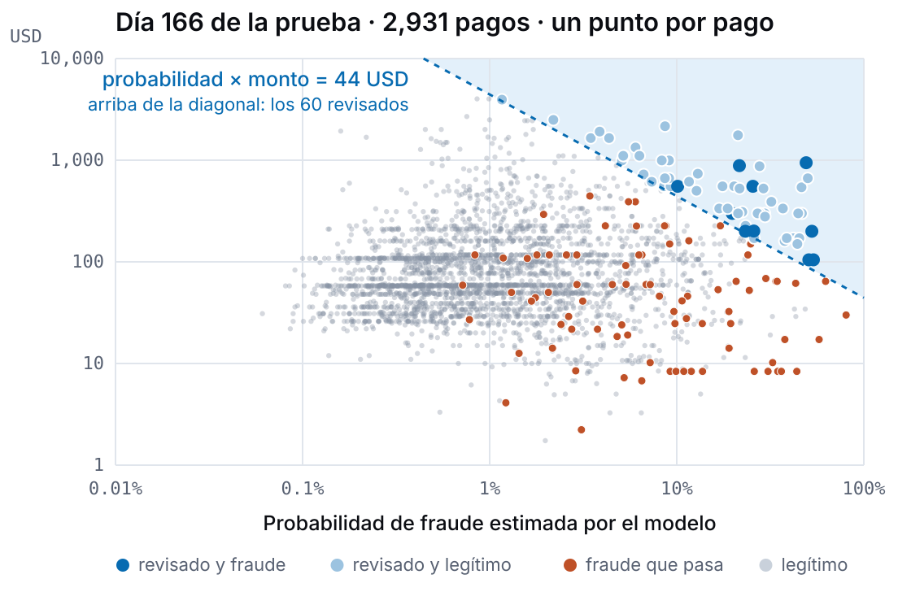
*Figura 2. Un día de prueba: cada pago según su probabilidad estimada y su monto. Los 60 revisados quedan sobre la diagonal de fraude esperado.*

### 1.2 El dinero de cada celda de la matriz de confusión

| | El pago es fraude | El pago es legítimo |
|---|---|---|
| Se revisa | Fraude detenido: **la métrica que se maximiza** | Una revisión usada sin recuperar nada |
| No se revisa | Contracargo: se pierde el monto completo | Sin costo |

Con un cupo fijo, la suma de las celdas de la fila "se revisa" no cambia entre políticas. Cada revisión asignada
a un pago legítimo o a un fraude pequeño deja fuera un fraude más grande. Por eso la métrica es una sola celda:
dólares de fraude dentro de la cola. La sección 5.7 agrega un costo por revisión y deja que cada política elija
su propio cupo.

El curso presenta la regla de decisión "actuar si p > C / LTV". Aquí el valor en riesgo de cada pago es su
monto, así que la regla equivale a revisar cuando probabilidad × monto supera el costo de revisar. Por eso todas
las políticas ordenan por fraude esperado y no por probabilidad.

### 1.3 Mejora significativa, fijada antes de abrir la prueba

Las hipótesis se escribieron en `docs/protocolo.md` antes de leer los días 121 a 182. Las ventajas se miden en
dólares de fraude en la cola con K = 60. Los intervalos provienen de un bootstrap pareado de 1,000 réplicas que
remuestrea días con reemplazo, los mismos para todas las políticas.

| Hipótesis | Condición en cada mes de prueba |
|---|---|
| H1 | El modelo supera a la mejor regla por al menos 20% y el límite inferior del IC 95% es mayor que cero |
| H2 | El modelo supera a la mejor logística por al menos 10% y el límite inferior del IC 95% es mayor que cero |
| H3 | El modelo (probabilidad × monto) supera al mismo modelo ordenado solo por probabilidad; límite inferior mayor que cero |

**Éxito del caso:** H1, H2 y H3 en los dos meses. El protocolo registró un riesgo antes de la prueba: en el
segundo bloque de desarrollo la ventaja sobre la logística fue de solo 3.9%, por debajo de la barra de H2. La
barra no se bajó.

## 2. Comprensión de los datos

### 2.1 Fuente

IEEE-CIS Fraud Detection, la competencia de Kaggle de 2019 con datos de Vesta: archivo de entrenamiento con
transacciones e identidad unidas, en la copia pública OpenML 46858. `datos/fuente.json` guarda la dirección y la
huella SHA-256 del archivo, y el código la verifica en cada lectura.

- 590,540 pagos en 182 días relativos. `TransactionDT` está en segundos desde una referencia anonimizada; el día
  es `TransactionDT // 86400`.
- Columnas: monto, producto, seis campos de tarjeta, dirección, distancia, dominios de correo, coincidencias
  `M1`–`M9`, 40 campos de identidad y dispositivo (`id_01`–`id_38`, `DeviceType`, `DeviceInfo`), `D1` y 367
  columnas opacas construidas por Vesta (`C1`–`C14`, `D2`–`D15`, `V1`–`V339`). La copia de OpenML repite 23
  campos de identidad con otro nombre (`id-01`, …); no se usan.
- La etiqueta `isFraud` marca el contracargo reportado y, según la descripción de Vesta, se propaga a los pagos
  posteriores de la misma cuenta, dirección o correo.

### 2.2 Lo que muestran los datos (días 1 a 120)

| Medida | Valor |
|---|---|
| Pagos | 414,542 |
| Pagos por día (mediana) | 3,180 |
| Tasa de fraude | 3.5% |
| Fraude en dólares | 2.13 millones |
| Monto mediano: fraude / legítimo | 76 / 69 USD |
| Cupo de 60 como parte de los pagos del día | 1.9% |
| Fraude en dólares del 1%, 5% y 10% de pagos de mayor monto | 8%, 36% y 53% |

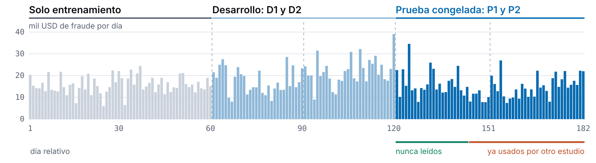
*Figura 3. Fraude diario en dólares, días 1 a 182, según su uso: entrenamiento, desarrollo y prueba.*

**El dinero se concentra en los montos altos.** La mediana del monto es parecida en las dos clases, pero el 10%
de pagos de mayor monto reúne 53% del fraude en dólares. Ordenar solo por probabilidad llenaría la cola de
fraudes pequeños.

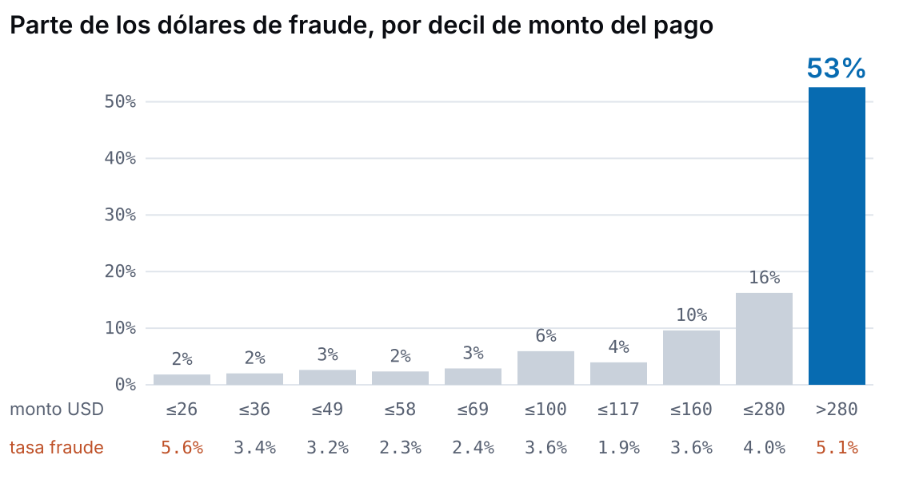
*Figura 4. Parte del fraude en dólares por decil de monto y tasa de fraude de cada decil.*

**Producto.** W concentra 72% de los pagos y 64% del fraude en dólares, con una tasa de 2.1%. C tiene la tasa
más alta, 11.2%.

| Producto | Pagos | Tasa de fraude | Parte de los pagos | Parte del fraude en USD |
|---|---:|---:|---:|---:|
| W | 298,873 | 2.1% | 72% | 64% |
| C | 50,136 | 11.2% | 12% | 13% |
| R | 30,185 | 3.5% | 7% | 12% |
| H | 28,134 | 4.5% | 7% | 10% |
| S | 7,214 | 6.0% | 2% | 2% |

**El cliente.** Vesta no publica un identificador de cliente. La columna `D1` registra los días desde el alta de
la tarjeta; restada del día del pago da una fecha de alta fija. Tarjeta (`card1`) + dirección (`addr1`) + fecha de
alta identifican 164,985 clientes, contra 12,251 valores de `card1`. El 77% de los fraudes ocurre en clientes con
dos o más pagos. La tasa de fraude depende del tiempo desde el pago anterior del mismo cliente:

| Tiempo desde el pago anterior | Pagos | Tasa de fraude |
|---|---:|---:|
| Menos de 1 hora | 66,951 | 6.8% |
| 1 a 24 horas | 56,774 | 5.3% |
| 1 a 7 días | 47,310 | 3.5% |
| Más de 7 días | 78,513 | 1.2% |
| Primer pago del cliente | 164,994 | 2.6% |

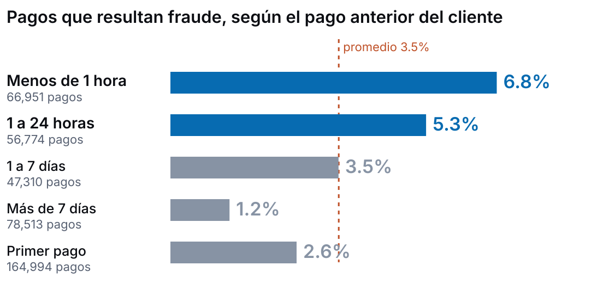
*Figura 5. Tasa de fraude según el tiempo desde el pago anterior del mismo cliente.*

### 2.3 Calidad de los datos

| Hallazgo | Tratamiento |
|---|---|
| Dispositivo ausente en 74% de los pagos; `dist1` en 62%; `id_01` en 73% | Indicador de faltante en cada numérica; categoría propia en cada categórica |
| Dirección ausente en 11%; correo en 16% | Se conservan: el faltante también es informativo |
| Fechas relativas en segundos | Días relativos; cupo y evaluación por día |
| 62% de los clientes con algún fraude tienen todos sus pagos marcados | La etiqueta se propaga a la cuenta; se declara como advertencia |
| 367 columnas opacas `C`, `D`, `V` sin fecha de cálculo documentada | Fuera del modelo final; solo diagnóstico. `D1` sirve para reconstruir al cliente |

## 3. Preparación de los datos

### 3.1 Historial sin información futura

Los pagos se ordenan por segundo. Para cinco llaves se calculan cinco medidas con **solo pagos de segundos
estrictamente anteriores** y sin usar la etiqueta:

| Llave | Campos |
|---|---|
| tarjeta | `card1` |
| tarjeta y dirección | `card1` + `addr1` |
| tarjeta, dirección y correo | `card1` + `addr1` + `P_emaildomain` |
| tarjeta completa | `card1` a `card6` |
| cliente | `card1` + `addr1` + fecha de alta (día − `D1`) |

Medidas por llave: pagos previos, pagos en el último día, pagos en la última semana, segundos desde el pago
anterior y razón entre el monto y el promedio de los montos previos. El cálculo (`_historial` en
`src/revisar/datos.py`) usa búsqueda binaria sobre llave × segundo, con lado izquierdo: dos pagos del mismo
segundo no se ven entre sí. El cuaderno lo demuestra con un ejemplo de cuatro pagos.

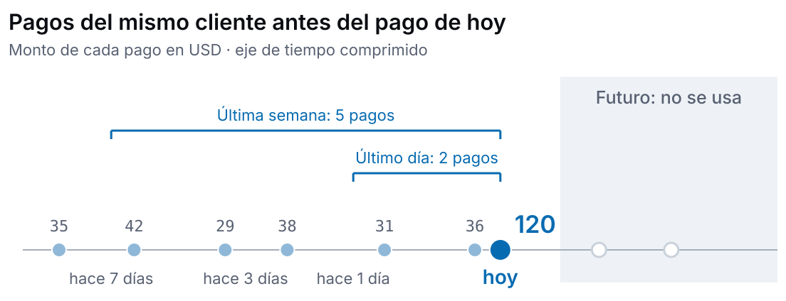
*Figura 6. Historial de un cliente visto desde el pago de hoy: solo cuentan los pagos anteriores.*

### 3.2 Conjuntos de variables y matriz de diseño

| Conjunto | Contenido | Variables | Papel |
|---|---|---:|---|
| F1 | Monto, log del monto, centavos, hora, día de la semana, distancias, identidad y 37 categóricas | 67 | Punto de partida de la ablación |
| F2 | F1 + historial de las cuatro llaves de tarjeta | 87 | Elegible |
| F3 | F2 + `D1` + historial del cliente | 93 | Elegible; **modelo final** |
| F4 | F3 + 367 columnas opacas | 460 | Diagnóstico: no se sabe cuándo se calculan |

La matriz de diseño es la misma para la logística, XGBoost y la red: transformación por cuantiles a normal (200
cuantiles) en las numéricas, imputación con la mediana más un indicador de faltante, y one-hot en las categóricas
con un mínimo de 50 casos y una categoría para valores infrecuentes. Todo se ajusta solo con el entrenamiento de
cada bloque. El desbalance (3.5% de fraude) no se repondera, para no deformar la probabilidad que después se
multiplica por el monto; ponderar por monto se evaluó como política aparte y dio menos dinero.

### 3.3 Controles contra la fuga de información

| Riesgo | Control | Cómo se comprueba |
|---|---|---|
| El futuro entra al entrenamiento | Cada bloque entrena con pagos de 30 días o más antes de su primer día | Afirmación en la carga |
| El historial ve el futuro | Solo segundos estrictamente anteriores | Búsqueda binaria con lado izquierdo; ejemplo en el cuaderno |
| La etiqueta entra en una variable | Ninguna variable usa la etiqueta; las tasas de las reglas salen solo del entrenamiento, suavizadas con 50 casos | Con etiquetas permutadas el modelo cae de 264 a 117 mil USD en D2, por debajo de ordenar por monto |
| Transformar con datos de evaluación | Cuantiles, medianas y one-hot se ajustan con el entrenamiento de cada bloque | Un solo objeto de diseño por bloque |
| Columnas de origen desconocido | `C`, `D` y `V` fuera del modelo | Su efecto se reporta aparte como F4 |
| Ajustar con la prueba | Protocolo congelado con huellas SHA-256 antes del día 121; una sola corrida | `scripts/03_prueba.py` verifica las huellas y se niega a correr si algo cambió |

## 4. Modelado

### 4.1 Diseño temporal

| Uso | Días evaluados | Entrena con |
|---|---|---|
| Desarrollo D1 | 61–90 | 1–30 |
| Desarrollo D2 | 91–120 | 1–60 |
| Prueba P1 | 121–151 | 1–90 |
| Prueba P2 | 152–182 | 1–121 |

El margen de 30 días entre el entrenamiento y el periodo evaluado representa el tiempo en que madura la etiqueta:
un contracargo puede tardar semanas en llegar. Todas las decisiones se tomaron con D1 y D2.

### 4.2 Políticas comparadas

- **Reglas.** Tasa de fraude histórica suavizada × monto, por tarjeta (`card1`), por segmento (producto × red ×
  tipo de tarjeta × dispositivo), por correo × producto, por producto × decil de monto y por velocidad de la
  tarjeta; además, mayor monto primero. Son reglas fuertes: usan la tasa observada en el entrenamiento y ya
  ordenan por fraude esperado.
- **Lineal.** Logística L2 con C ∈ {0.001, 0.003, 0.01, 0.03, 0.1}, sobre F2 y F3, con la misma matriz de
  diseño.
- **Flexibles, sobre F2 y F3.** Árbol CART de profundidad 3, bosque aleatorio, XGBoost, XGBoost ponderado por
  monto, red MLP y ensamble XGBoost + bosque. Hiperparámetros fijos, escritos antes del torneo (XGBoost: 600
  árboles, profundidad 8, tasa de aprendizaje 0.05).
- **Otros.** Bosque de aislamiento como política no supervisada; XGBoost sobre F1 y F4 para la ablación; oráculo
  como techo.

### 4.3 Selección en desarrollo

La regla de selección (`docs/criterio_desarrollo.md`) se escribió antes de correr el torneo:

1. El modelo final es la combinación de modelo flexible y conjunto (F2 o F3) con más dólares en D1 + D2.
2. Si gana el ensamble por menos de 1% sobre el mejor modelo único, se elige el modelo único.
3. El elegido debe superar a la mejor logística en los dos bloques; si no, el modelo final es la logística.
4. La mejor regla y la mejor logística son las de más dólares en D1 + D2.
5. El comparador publicado es el modelo final ordenado solo por probabilidad, como en la competencia.

Miles de dólares de fraude en la cola, K = 60:

| Política | D1 | D2 | Total |
|---|---:|---:|---:|
| **XGBoost F3** | **183.7** | **264.2** | **447.9** |
| Ensamble XGBoost + bosque, F3 | 164.6 | 273.0 | 437.6 |
| XGBoost F2 | 171.0 | 256.4 | 427.4 |
| XGBoost ponderado por monto, F3 | 168.6 | 244.3 | 413.0 |
| Bosque aleatorio, F3 | 142.9 | 255.0 | 397.9 |
| **Mejor logística: C = 0.003, F3** | 142.8 | 254.2 | 397.0 |
| Red MLP, F3 | 117.1 | 165.9 | 283.1 |
| **Mejor regla: tasa por segmento × monto** | 73.3 | 201.5 | 274.8 |
| Tasa por tarjeta × monto | 78.9 | 183.1 | 262.0 |
| Tabla producto × decil de monto | 81.6 | 171.6 | 253.2 |
| Árbol CART de profundidad 3, F3 | 83.4 | 159.9 | 243.3 |
| Mayor monto primero | 64.7 | 171.0 | 235.7 |
| Bosque de aislamiento | 68.9 | 132.4 | 201.3 |
| Mismo XGBoost ordenado solo por probabilidad | 100.8 | 100.5 | 201.3 |

XGBoost F3 supera a la logística en los dos bloques (+28.7% y +3.9%), así que se cumple la condición 3. El
ensamble queda por debajo y no se elige.

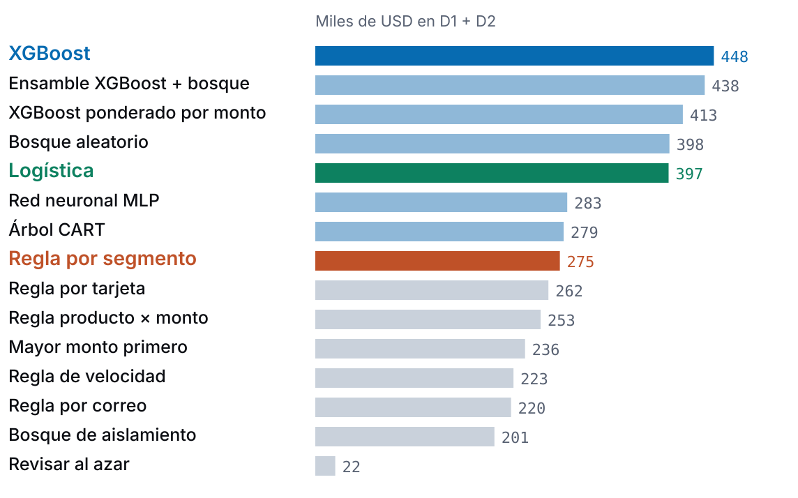
*Figura 7. Dólares de fraude en la cola por política en desarrollo, días 61 a 120.*

### 4.4 Ablación de variables

Con el mismo XGBoost, en miles de dólares:

| Conjunto | D1 | D2 | Total |
|---|---:|---:|---:|
| F1 · descriptivas | 172.2 | 254.7 | 426.9 |
| F2 · + historial de tarjeta | 171.0 | 256.4 | 427.4 |
| F3 · + cliente | 183.7 | 264.2 | 447.9 |
| F4 · + columnas opacas | 219.7 | 299.0 | 518.8 |

El historial por tarjeta agrega poco; el del cliente agrega 21 mil dólares. Las columnas opacas agregarían 71 mil
más, pero la descripción pública no dice en qué momento se calculan, y una variable que puede contener
información posterior al pago no es defendible en producción. Quedaron fuera antes de la prueba.

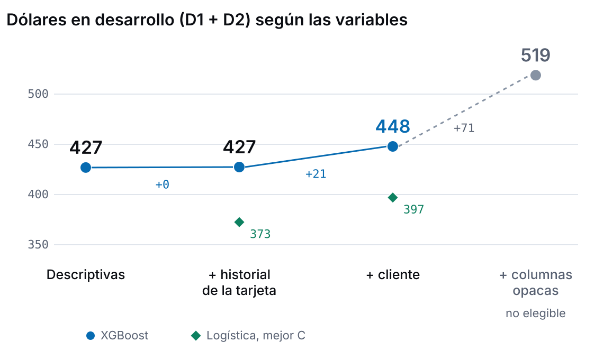
*Figura 8. Dólares en desarrollo al agregar conjuntos de variables al mismo XGBoost; los rombos corresponden a la logística.*

### 4.5 Regularización de la logística

Dólares (miles) y AUC en desarrollo con F3:

| C | 0.001 | 0.003 | 0.01 | 0.03 | 0.1 |
|---|---:|---:|---:|---:|---:|
| Dólares | 382.8 | **397.0** | 388.7 | 377.0 | 357.4 |
| AUC | 0.803 | 0.807 | **0.809** | 0.807 | 0.801 |

El AUC elegiría C = 0.01; los dólares eligen C = 0.003. La penalización se elige con la métrica de la decisión.

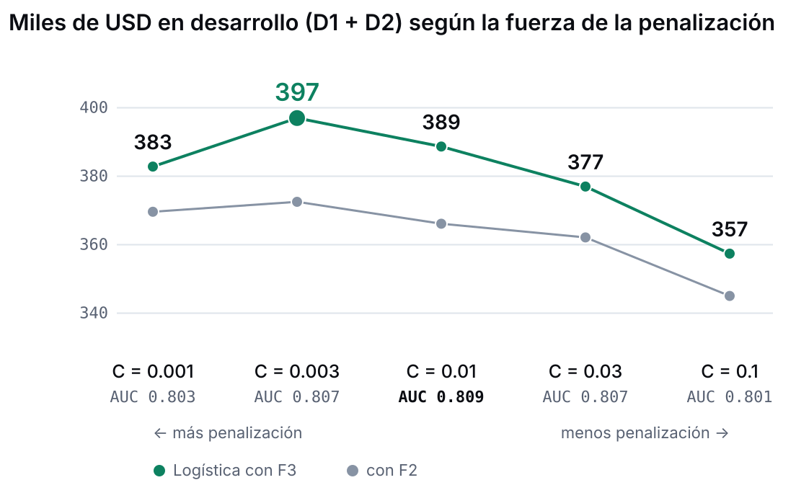
*Figura 9. Dólares y AUC de la logística según la penalización C.*

### 4.6 Diagnósticos en desarrollo

**Importancia por permutación en dólares (D2).** Al permutar el monto se pierden 74.7 mil dólares; le siguen las
coincidencias `M1`–`M9` (36.9 mil), el dispositivo y la identidad (36.8 mil) y el historial del cliente (34.8
mil). El historial de la tarjeta aporta cerca de cero porque el del cliente ya contiene esa información.

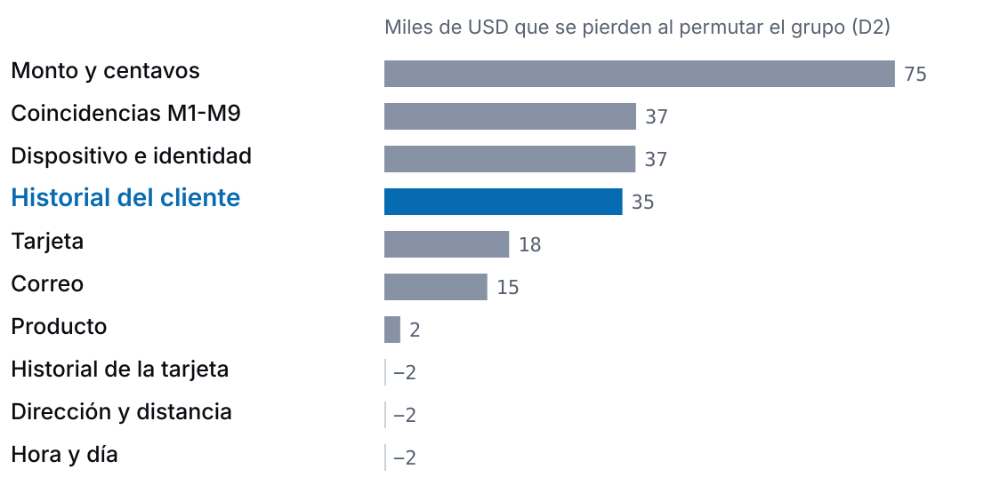
*Figura 10. Dólares que pierde la cola al permutar cada grupo de variables, D2.*

**Controles en D2.** El modelo lleva 264.2 mil dólares a la cola; con las etiquetas permutadas, 117.3 mil (menos
que ordenar por monto, 171.0 mil); revisar al azar, 12.3 mil. El árbol de profundidad 3 ofrece reglas legibles y
lleva 159.9 mil. El bosque de aislamiento queda abajo: la rareza por sí sola no identifica fraude.

## 5. Evaluación en los dos meses de prueba

Con todo congelado, `scripts/03_prueba.py` entrenó con los días 1–90 para evaluar P1 y con los días 1–121 para
evaluar P2, y se corrió una sola vez. El cuaderno recalcula los dólares a partir de los puntajes guardados de
cada pago con el código de evaluación congelado; la diferencia con los resultados guardados es cero.

### 5.1 Resultado principal

Ver la tabla del resumen ejecutivo. El orden del desarrollo se mantiene en los dos meses: primero el modelo,
después la logística y luego la mejor regla. El modelo alcanza 49% y 52% del techo del oráculo; la regla, 38% y
32%.

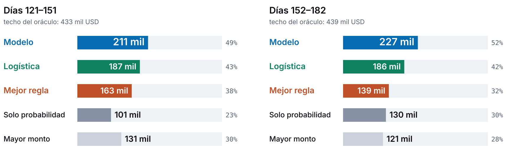
*Figura 11. Dólares de fraude en la cola por política en los dos meses de prueba; la barra gris es el oráculo.*

### 5.2 Contrastes pareados y veredicto

| Mes | Contra | Ventaja | IC 95% | Barra | Cumple |
|---|---|---:|---|---|---|
| P1 | Mejor regla | +30.1% | +16.8% a +49.8% | ≥ 20% | Sí |
| P1 | Mejor logística | +13.1% | +7.0% a +21.8% | ≥ 10% | Sí |
| P1 | Solo probabilidad | +110.1% | +76.9% a +147.4% | > 0 | Sí |
| P2 | Mejor regla | +63.4% | +39.7% a +97.0% | ≥ 20% | Sí |
| P2 | Mejor logística | +22.2% | +8.7% a +39.3% | ≥ 10% | Sí |
| P2 | Solo probabilidad | +74.5% | +54.7% a +98.3% | > 0 | Sí |

Los intervalos remuestrean días: cada réplica toma 31 días con reemplazo, los mismos para todas las políticas, y
conserva la cola que cada política eligió en cada día. La comparación con la logística es la más exigente porque
usa la misma información y la misma matriz de diseño.

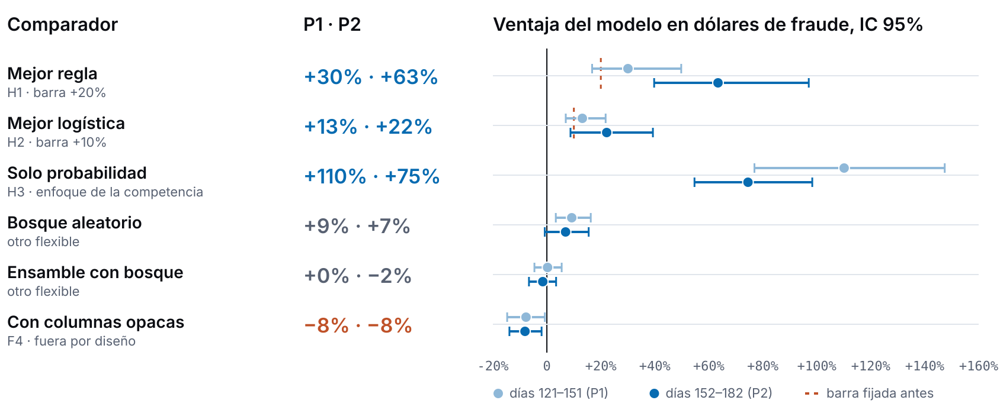
*Figura 12. Ventaja del modelo contra cada comparador con su intervalo de 95%; las líneas marcan las barras fijadas antes.*

El modelo supera a la regla en 26 y 28 de 31 días, a la logística en 24 y 24, y a ordenar por probabilidad en 31
y 30.

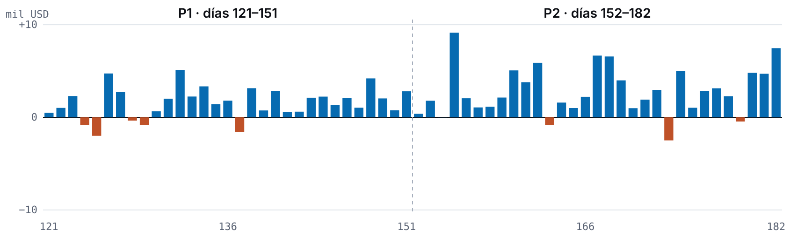
*Figura 13. Diferencia diaria en dólares entre el modelo y la regla en los 62 días de prueba.*

### 5.3 La matriz de confusión en dólares

| Días 152–182 (P2) | Modelo | Mejor regla |
|---|---:|---:|
| Fraudes revisados | 511 | 190 |
| Fraude revisado (miles de USD) | **226.7** | 138.7 |
| Revisiones a pagos legítimos | 1,349 | 1,670 |
| Fraude que pasa (miles de USD) | 250.7 | 338.6 |
| Precisión de la cola | 27% | 10% |
| Parte del fraude del mes en la cola | 47% | 29% |

En P1, el modelo revisa 605 fraudes (211.4 mil dólares) con una precisión de 33%, y la regla 218 (162.6 mil) con
12%. Con el mismo número de revisiones, el modelo cambia qué pagos entran a la cola: menos revisiones a pagos
legítimos y más fraude en dólares.

### 5.4 Las métricas de clasificación del curso

Los dos meses juntos, 3,720 revisiones:

| Cola | Exactitud | Precisión | Recall | F1 | ROC-AUC (P1 / P2) | Miles de USD en la cola |
|---|---:|---:|---:|---:|---|---:|
| Modelo (probabilidad × monto) | 0.957 | 0.300 | 0.184 | 0.228 | 0.828 / 0.804 | **438** |
| Solo probabilidad | 0.964 | 0.453 | 0.278 | 0.345 | 0.870 / 0.875 | 231 |
| Mejor logística | 0.953 | 0.191 | 0.117 | 0.146 | 0.776 / 0.743 | 372 |
| Mejor regla | 0.949 | 0.110 | 0.067 | 0.083 | 0.690 / 0.661 | 301 |
| Mayor monto primero | 0.947 | 0.060 | 0.037 | 0.046 | 0.511 / 0.474 | 252 |
| No revisar nada | 0.966 | — | 0.000 | 0.000 | — | 0 |

No revisar ningún pago tiene la mayor exactitud, porque solo 3.4% de los pagos de la prueba es fraude. Las demás
métricas de conteo prefieren ordenar solo por probabilidad, que lleva 47% menos dinero a la cola que el modelo.
Estas métricas cuentan aciertos sin ponderar el monto; la decisión se mide en dólares. El AUC del ranking por
probabilidad × monto es menor que el del ranking por probabilidad porque el monto reordena pagos de probabilidad
parecida.

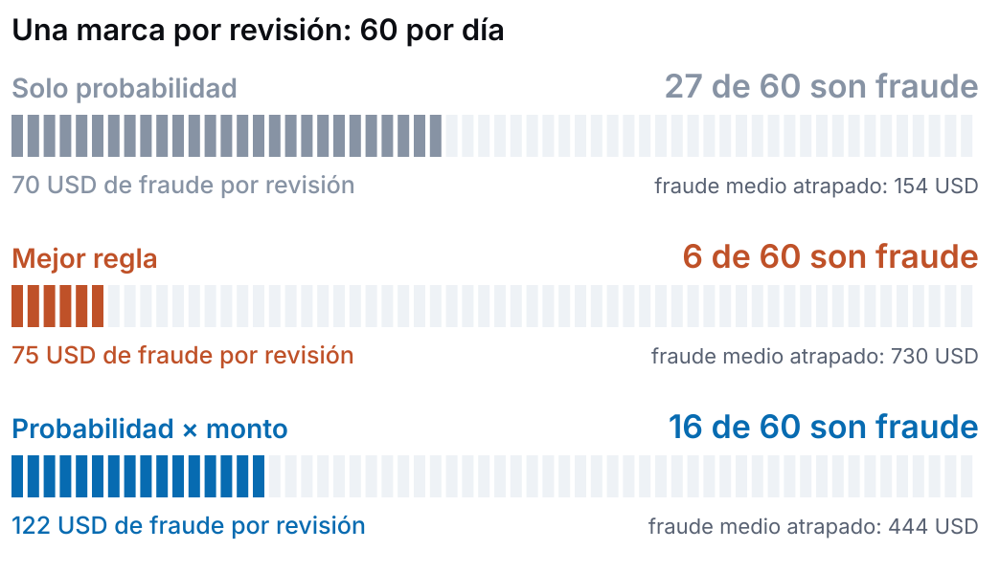
*Figura 14. Exactitud y dinero de cada cola: la exactitud más alta corresponde a no revisar nada.*

### 5.5 Curvas ROC, precisión–recall y ganancia

Con clases desbalanceadas, la curva ROC da una impresión favorable: el punto de operación del modelo revisa 1.5%
de los pagos legítimos y aparece junto al eje vertical. La curva precisión–recall muestra el mismo punto con
70% de las revisiones en pagos legítimos; la referencia del azar es la tasa de fraude.

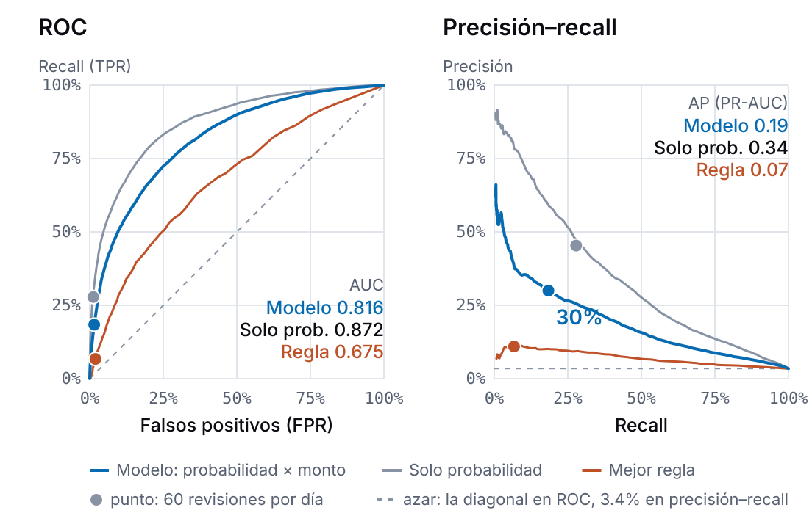
*Figura 15. Curvas ROC y precisión–recall en la prueba, con el punto de la cola de 60 por día.*

**Ganancia acumulada y lift.** Con el cupo, 2.1% de los pagos de cada día, el modelo captura 46% del fraude en
dólares, un lift de 22 sobre revisar al azar. El primer decil de cada día reúne 77% del dinero y 48% de los
fraudes. Para igualar los dólares de la regla, el modelo necesita 55% menos revisiones.

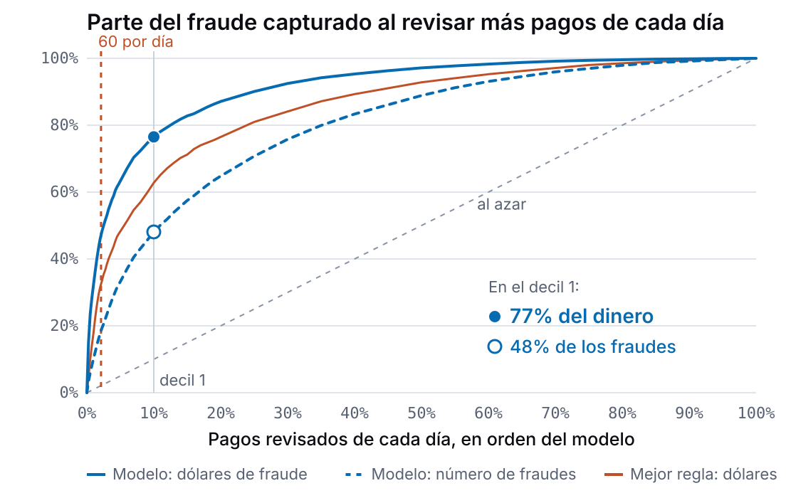
*Figura 16. Ganancia acumulada: parte del fraude capturado al revisar más pagos de cada día, en dólares y en número.*

### 5.6 Calibración

La regla del umbral supone probabilidades calibradas.

| Días 121–182 | Probabilidad media | Tasa observada | Error de Brier |
|---|---:|---:|---:|
| Modelo | 3.2% | 3.4% | 0.0271 |
| Logística | 4.3% | 3.4% | 0.0309 |
| Asignar a todos la tasa media | — | — | 0.0333 |

El modelo queda cerca de la diagonal, aunque subestima entre 2% y 20%; su error de Brier es 18% menor que el de
asignar la tasa media. La logística sobreestima en el tramo alto (estima 32% donde se observa 19%) y mejora el
Brier en 7%. Dentro de la cola, el fraude esperado por el modelo (150.7 y 214.5 mil dólares) queda por debajo del
observado (211.4 y 226.7 mil).

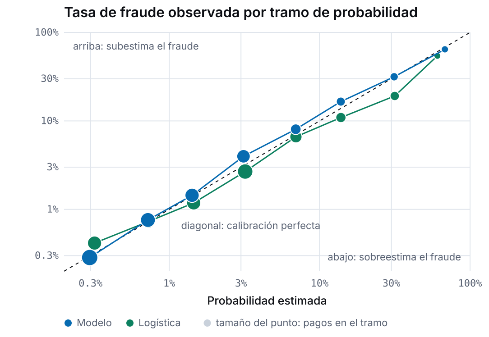
*Figura 17. Diagrama de calibración de la prueba: probabilidad estimada contra tasa observada.*

### 5.7 Costo por revisión y umbral de decisión

Si revisar cuesta C dólares, se revisa un pago cuando probabilidad × monto supera C. La curva de beneficio neto
en la prueba (lo recuperado menos el costo de revisar) tiene su máximo en umbrales de 9, 17 y 33 dólares para
costos de 10, 20 y 50, un poco por debajo de cada costo, como corresponde a un modelo que subestima la
probabilidad. Revisar 60 pagos al día equivale a un umbral mediano de 36 dólares de fraude esperado.

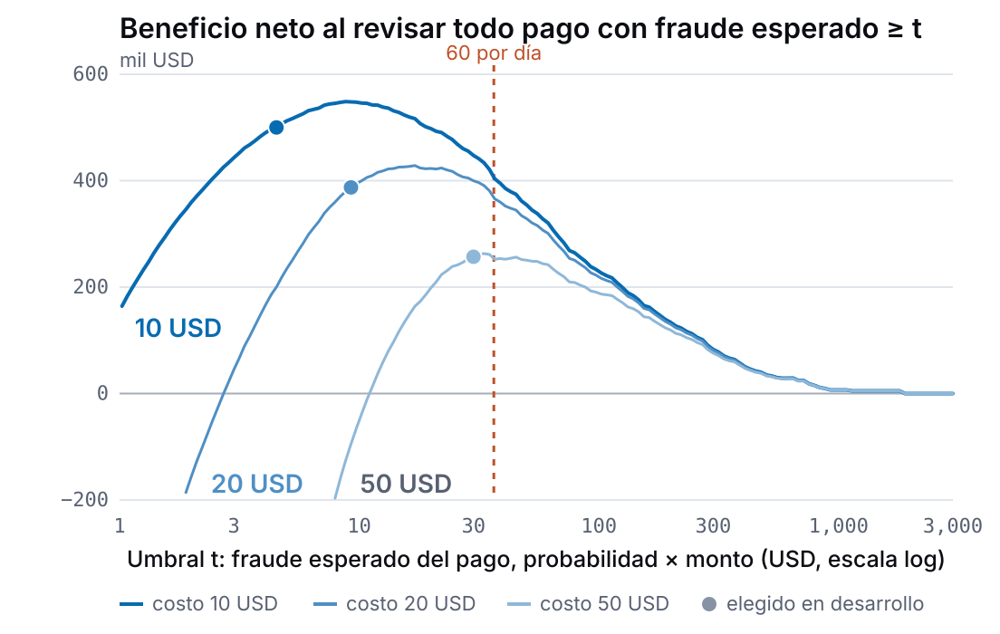
*Figura 18. Beneficio neto en la prueba según el umbral de fraude esperado, para tres costos por revisión.*

Para cada costo y cada supuesto de recuperación, cada política elige su cupo con las curvas de desarrollo y el
neto se mide en la prueba (miles de dólares):

| Costo por revisión | Recupera | Cupo diario del modelo | Modelo | Logística | Regla |
|---:|---:|---:|---:|---:|---:|
| 1 | 100% | 1,498 | 832.1 | 815.5 | 795.9 |
| 5 | 100% | 621 | 648.0 | 588.8 | 544.1 |
| 10 | 100% | 450 | 513.4 | 465.0 | 399.3 |
| 20 | 100% | 178 | 423.1 | 358.2 | 268.9 |
| 50 | 100% | 66 | 249.4 | 180.1 | 114.2 |
| 100 | 100% | 30 | 128.0 | 54.0 | 0.0 |

El modelo deja más neto que la regla y que la logística en los 14 escenarios (siete costos, recuperación total o
de la mitad; la tabla completa está en el cuaderno). Con 100 dólares por revisión la regla deja de revisar y el
modelo todavía obtiene 128 mil.

### 5.8 Robustez

El fraude en dólares depende de pocos pagos grandes, así que la comparación se repitió sin ellos:

| Escenario | Regla, P1 | Logística, P1 | Regla, P2 | Logística, P2 |
|---|---:|---:|---:|---:|
| Principal: 60 por día | +30.1% | +13.1% | +63.4% | +22.2% |
| 30 por día | +80.6% | +13.6% | +89.8% | +28.6% |
| 120 por día | +25.7% | +12.0% | +44.1% | +15.5% |
| Sin pagos sobre el percentil 99 del entrenamiento | +20.6% | +8.8% | +58.0% | +22.1% |
| Monto topado en el percentil 99 | +37.1% | +15.6% | +77.9% | +28.7% |
| Días que gana el modelo | 26 de 31 | 24 de 31 | 28 de 31 | 24 de 31 |
| Días 121–144, que ningún estudio anterior leyó | +22.6% | +11.0% | — | — |

Contra la regla, la ventaja nunca baja de 20%. Contra la logística el margen es menor: el peor caso es +8.8%,
sin los pagos más caros en P1.

**Semilla del modelo.** El resultado publicado sale de una sola corrida, y el bootstrap remuestrea días, no el
entrenamiento. Después de la prueba, el modelo se reentrenó con diez semillas en otra máquina
(`scripts/10_semillas.py`). Las veinte corridas cumplen las tres hipótesis:

| Diez semillas | P1 | P2 |
|---|---|---|
| Fraude en la cola (miles de USD) | 207.2 a 218.3 | 223.2 a 232.3 |
| Ventaja contra la mejor regla | +27.4% a +34.3% | +60.9% a +67.5% |
| Ventaja contra la mejor logística | +11.1% a +17.1% | +19.2% a +24.1% |

Los dólares publicados (211.4 y 226.7) caen dentro del rango. Otra máquina no los reproduce al centavo: con la
semilla del protocolo da 217.6 y 230.3. La cifra exacta se mueve hasta 5% entre semillas; el veredicto, no.

**Margen de la etiqueta.** El protocolo supone que la etiqueta madura en 30 días; Vesta la da por definitiva a los
120. Con márgenes mayores, el modelo, la logística y la regla se reentrenaron en esa misma máquina
(`scripts/11_margen.py`). Ventaja del modelo:

| Margen | Entrena con los días (P1 / P2) | Regla, P1 | Logística, P1 | Regla, P2 | Logística, P2 |
|---|---|---:|---:|---:|---:|
| 30 días | 1–90 / 1–121 | +33.9% | +16.8% | +66.0% | +23.0% |
| 45 días | 1–75 / 1–106 | +23.6% | +6.7% † | +64.0% | +25.2% |
| 60 días | 1–60 / 1–91 | +28.5% | +11.8% | +49.9% | +15.3% |
| 90 días | 1–30 / 1–61 | +23.7% | +5.6% † | +41.5% | +8.0% † |

† El intervalo de 95% incluye el cero.

Contra la regla, la ventaja nunca baja de 23.6% y su intervalo queda sobre cero. Contra la logística baja a 5.6% y
8.0% con 90 días. De 30 a 90 días el modelo pierde 14.2% y 17.5% de sus dólares; la logística, 5.1% y 6.0%; la regla, 7.2% y
3.2%. Dos matices: con seis meses de datos, más margen también es menos entrenamiento, y cada fila usa una sola
semilla, que mueve la ventaja contra la logística unos 2 puntos.

### 5.9 Traza del dinero

Cada dólar de fraude del mes cae en una sola categoría y las cuatro suman el fraude total (miles de dólares):

| | Fraude del mes | Revisan ambos | Solo el modelo | Solo la regla | Ninguno |
|---|---:|---:|---:|---:|---:|
| P1 | 472.7 | 134.6 | 76.9 | 28.0 | 233.2 |
| P2 | 477.4 | 111.6 | 115.1 | 27.2 | 223.5 |

En las 1,308 y 1,196 revisiones en que difieren, el modelo encuentra 436 y 355 fraudes, con monto medio de 176 y
324 dólares; la regla encuentra 49 y 34, con monto medio de 572 y 799. La regla prioriza pagos muy grandes en
segmentos riesgosos, con baja precisión; el modelo encuentra fraudes medianos de clientes con historial
sospechoso. Más de 220 mil dólares al mes no los revisa ninguna de las dos.

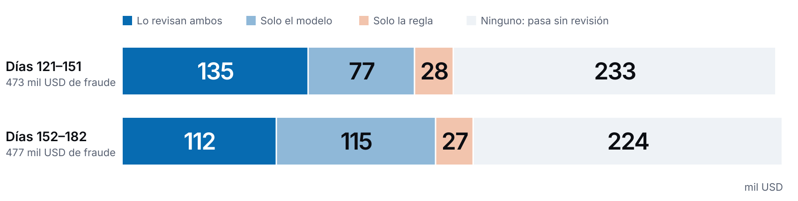
*Figura 19. Fraude de cada mes dividido en lo que revisan ambas políticas, solo el modelo, solo la regla o ninguna.*

### 5.10 Diagnósticos de la prueba que no son condición

- **Columnas opacas (F4).** XGBoost con F4 llevaría 229.2 y 246.7 mil dólares, 8.4% y 8.8% más que F3. La
  decisión de excluirlas se tomó antes y no cambia.
- **Ensamble.** XGBoost + bosque lleva 210.9 y 230.2 mil dólares, prácticamente igual que XGBoost solo; su
  complejidad adicional no se justifica.
- **Bosque de aislamiento.** 125.5 y 125.9 mil dólares, por debajo de la regla.

## 6. Mantenimiento: búsqueda de variables con validación cruzada temporal

Después de la prueba se preguntó si una mejor ingeniería de variables agregaba dinero. El diseño se registró en
`docs/anexo_variables.md` antes de correr y no modifica el protocolo ni el veredicto.

### 6.1 Diseño

- **Ocho grupos candidatos**, todos calculados con pagos de segundos estrictamente anteriores; las frecuencias se
  ajustan con el entrenamiento de cada bloque:

| Grupo | Qué mide |
|---|---|
| Ventanas | Pagos en la última hora y en 6 horas; dólares en 24 horas y en 7 días (tarjeta y cliente) |
| Perfil del monto | Desviación previa, z del monto, razón contra el máximo previo, monto repetido, días desde el primer pago |
| Novedad y diversidad | Correos, dispositivos y direcciones distintos ya vistos; si el de hoy es nuevo |
| Entidades compartidas | Tarjetas y clientes distintos por dispositivo; tarjetas por dirección + correo |
| Texto | Proveedor y país del correo, familia y versión del sistema, navegador y pantalla |
| Forma del monto | Número de decimales (conversión de moneda), monto entero, terminación .95 o .99 |
| Frecuencia | Frecuencia en el entrenamiento de tarjeta, dirección, correo, dispositivo, navegador, pantalla y cliente |
| Cliente fino | Tarjeta + dirección + alta + correo, con las cinco medidas de historial |

- **Validación cruzada temporal con origen móvil.** Tres ventanas internas de 15 días (61–75, 76–90 y 91–105),
  cada una con 30 días de margen sobre su entrenamiento.
- **Selección hacia adelante.** En cada ronda se prueba cada grupo restante sobre el conjunto vigente; el mejor
  entra solo si sube el total de las tres ventanas al menos 1% y mejora en al menos dos de ellas. Después, una
  pasada hacia atrás comprueba si quitar algún grupo aceptado mejora el total.
- **Hiperparámetros.** Una rejilla de cuatro combinaciones de profundidad y peso mínimo por hoja, con el número de
  árboles elegido por parada temprana en los últimos 10 días de entrenamiento de cada ventana; misma barra.
- **Confirmación.** Los días 106–120 no se usan en la búsqueda; ahí se compara el resultado contra F3.
- **Lectura de la prueba.** Una sola, al final, sin cambiar nada.

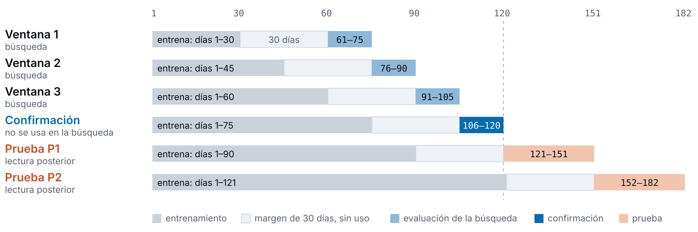
*Figura 20. Diseño de validación: tres ventanas internas con origen móvil, un bloque de confirmación y la prueba.*

### 6.2 Selección hacia adelante

| Ronda | Grupo aceptado | Ganancia en las tres ventanas | Ventanas en que mejora |
|---|---|---:|---:|
| 1 | Perfil del monto | +2.5% | 2 de 3 |
| 2 | Novedad y diversidad | +1.9% | 2 de 3 |
| 3 | Cliente fino | +1.6% | 3 de 3 |
| 4 | Ninguno (el mejor, ventanas, −2.0%) | — | 0 de 3 |

La pasada hacia atrás no quita ningún grupo. En las ventanas internas, el dinero pasa de 296.0 a 314.1 mil
dólares (+6.1%). La rejilla de hiperparámetros no supera la barra: la mejor combinación queda 1.5% abajo y mejora
en una de tres ventanas, así que se mantienen los hiperparámetros del protocolo. La parada temprana elige 618
árboles en la tercera ventana.

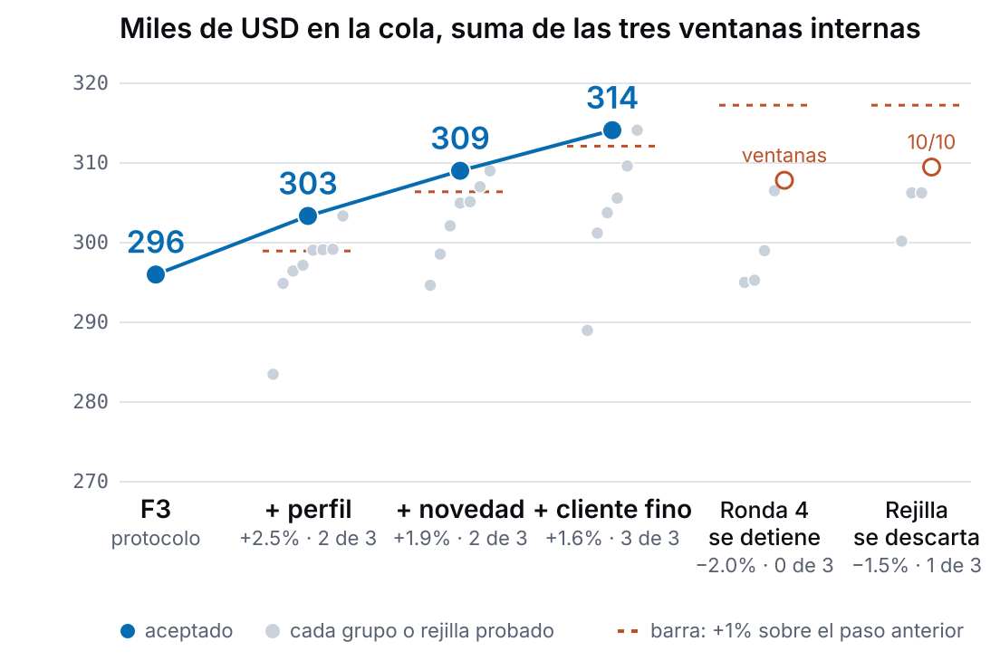
*Figura 21. Selección hacia adelante: dólares en las tres ventanas internas en cada ronda.*

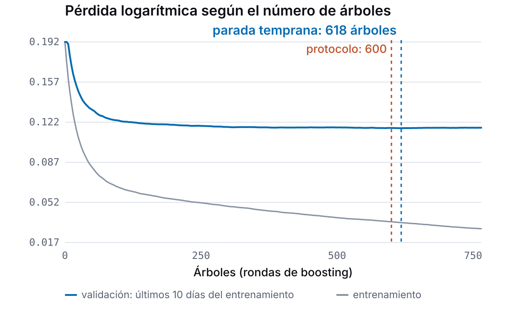
*Figura 22. Curva de aprendizaje de la tercera ventana: pérdida logarítmica en entrenamiento y validación.*

### 6.3 Confirmación y lectura de la prueba

| Días 106–120 (45,910 pagos) | Miles de USD | Contraste | Ventaja | IC 95% |
|---|---:|---|---:|---|
| XGBoost F3 | 167.3 | | | |
| XGBoost con variables nuevas | 158.4 | contra F3 | −5.3% | −9.6% a −1.1% |
| Logística F3 | 163.5 | | | |
| Logística con variables nuevas | 165.1 | contra logística F3 | +1.0% | −3.3% a +5.3% |
| Mejor regla | 139.0 | | | |

En los días de confirmación, el modelo con variables nuevas lleva 5.3% menos que F3 y gana 6 de 15 días. La
ganancia interna provenía de elegir y medir con las mismas ventanas; el bloque de confirmación existe para
detectarlo. En la lectura posterior de la prueba la diferencia es de +1.5% (IC −2.4% a +6.2%) en P1 y 0.0% (IC
−3.1% a +3.8%) en P2. En la logística, las mismas variables suman +5.1% y +2.2%. F3 reconstruido por el anexo
reproduce exactamente los dólares de la prueba congelada.

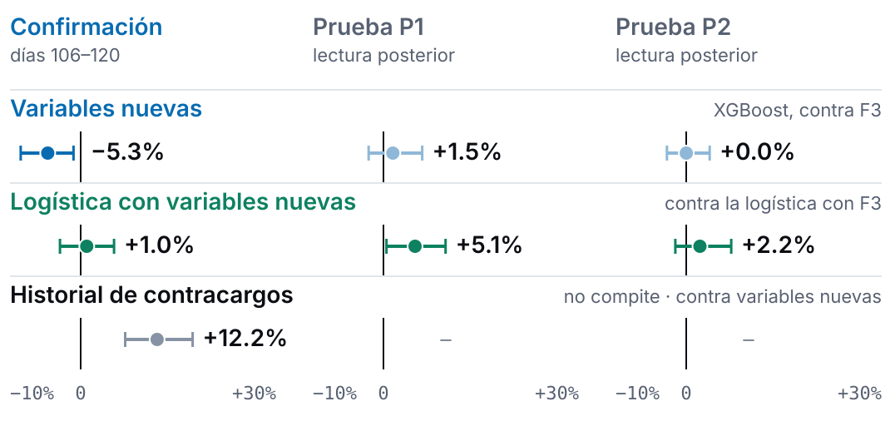
*Figura 23. Ventaja de las variables nuevas, con intervalos de 95%, en la confirmación y en los dos meses de prueba.*

**Historial de contracargos.** Un grupo adicional usa etiquetas con 30 días o más de antigüedad (pagos ya
etiquetados y fraudes conocidos por cliente y tarjeta). Suma 5.8% en las ventanas internas y 12.2% en la
confirmación (IC +7.1% a +17.9%), pero aprende cómo Vesta propaga la etiqueta a la cuenta, no cómo se comporta
el fraude nuevo. Se reporta como cota y no se usa.

**Conclusión del anexo.** Ninguna variable nueva supera a F3 fuera de las ventanas que la eligieron. F3 se
mantiene y el veredicto del protocolo no cambia. El procedimiento queda como protocolo de mantenimiento para
evaluar cambios futuros al modelo.

## 7. Despliegue

| Etapa | Cuándo | Qué se hace |
|---|---|---|
| Operación | Cada noche | Se puntúan los pagos del día y los 60 con mayor fraude esperado pasan a la cola. La decisión sobre cada pago sigue siendo del equipo |
| Reentrenamiento | Cada semana | Con los pagos de más de 30 días, que ya tienen etiqueta |
| Piloto | Primer mes | Los días se asignan al azar a la cola actual o a la del modelo, para medir el efectivo recuperado |
| Monitoreo | Cada semana | Dólares por revisión, precisión, monto medio de la cola y mezcla de productos |
| Respaldo | Si el modelo falla | Si durante dos semanas queda por debajo de la regla, se vuelve a la tabla por segmento |

**Cupo.** Si el equipo conoce el costo de una revisión, el cupo puede salir de la curva de beneficio (sección
5.7) en lugar de fijarse en 60; el modelo deja más neto en todos los costos evaluados.

**Cambios al modelo.** Cualquier variable o hiperparámetro nuevo pasa por el procedimiento de la sección 6:
validación temporal con origen móvil, barra fijada antes y un bloque de confirmación que la búsqueda no usa.

## 8. Limitaciones

- **Dinero etiquetado, no efectivo.** La métrica supone que revisar un fraude evita su monto completo. Mide
  exposición que entra a la cola. El piloto mediría el efectivo recuperado.
- **Práctica actual desconocida.** Vesta no publica su regla de revisión; la representa la mejor de seis reglas
  de tasa histórica × monto.
- **Etiqueta propagada.** El contracargo se propaga a los pagos posteriores de la misma cuenta. 77% de los
  fraudes ocurre en clientes con dos o más pagos, así que parte del acierto proviene de reconocer cuentas ya
  marcadas. Afecta a todas las políticas que usan historial.
- **Seis meses de 2017–2018 con fechas relativas.** No hay estacionalidad anual ni fechas de calendario.
- **Margen de 30 días.** Es un supuesto sobre cuándo madura la etiqueta. Con 45, 60 o 90 días la ventaja sobre
  la regla se mantiene, pero el modelo pierde más dinero que las otras políticas y su ventaja sobre la logística
  baja hasta 5.6% (sección 5.8). Lo que XGBoost agrega a una logística depende de qué tan rápido llegan los
  contracargos.
- **Días con lectura previa.** Un estudio anterior con estos datos usó los días 145–182 con otra decisión. Ninguna
  elección de este proyecto los usó, y los días 121–144 se reportan aparte: la ventaja contra la regla ahí es
  +22.6% (IC +10.3% a +39.1%).

## 9. Técnicas del curso

| Técnica | Dónde se usa |
|---|---|
| CRISP-DM | Estructura del reporte, del cuaderno y de la presentación |
| Matriz de confusión con costos y beneficios | Secciones 1.2 y 5.3 |
| Paradoja de la exactitud, precisión, recall, F1 | Sección 5.4 |
| Curvas ROC y precisión–recall, AUC | Secciones 4.5, 5.4 y 5.5 |
| Ganancia acumulada y lift | Sección 5.5 |
| Umbral de decisión con costos (p > C / LTV) y curva de beneficio | Secciones 1.2 y 5.7 |
| Calibración y error de Brier | Sección 5.6 |
| Ingeniería de variables: recencia, frecuencia y monto (RFM), ventanas de velocidad, novedad | Secciones 3.1 y 6.1 |
| Transformación por cuantiles, imputación con indicador, one-hot con mínimo, codificación por frecuencia | Sección 3.2 y anexo |
| Fuga de información | Sección 3.3 |
| Árboles de decisión, bosque aleatorio, boosting (XGBoost), redes, ensambles | Sección 4 |
| Regularización L2 | Sección 4.5 |
| Detección de anomalías (bosque de aislamiento) | Secciones 4.6 y 5.10 |
| Importancia por permutación | Sección 4.6 |
| Validación temporal, bootstrap pareado | Secciones 4.1 y 5.2 |
| Validación cruzada temporal, selección hacia adelante, rejilla con parada temprana, curva de aprendizaje | Sección 6 |

## 10. Reproducibilidad

```text
python scripts/00_descargar.py        # copia pública OpenML 46858; verifica la huella SHA-256
python scripts/01_exploracion.py      # días 1-120
python scripts/02_desarrollo.py       # torneo de desarrollo y selección
python scripts/03_prueba.py           # prueba congelada: verifica las huellas del protocolo
python scripts/04_resumen.py
python scripts/04b_lecciones.py       # costos, calibración, regularización
python scripts/04c_curvas_curso.py    # métricas y curvas del curso
python scripts/06_variables.py        # anexo: búsqueda de variables (días 1-120)
python scripts/07_anexo_prueba.py     # anexo: lectura posterior de la prueba
python scripts/05_presentacion.py --pdf
python scripts/08_cuaderno.py         # cuaderno ejecutado
python scripts/09_reporte.py --pdf    # este reporte
python scripts/10_semillas.py         # robustez: diez semillas de XGBoost
python scripts/11_margen.py           # robustez: la etiqueta tarda 45, 60 o 90 días
```

- `docs/protocolo.md` guarda las hipótesis, la selección y las huellas SHA-256 de `datos.py`, `politicas.py`,
  `evaluacion.py`, `03_prueba.py` y `desarrollo_seleccion.json`, calculadas con finales de línea LF.
- `docs/criterio_desarrollo.md` es la regla de selección, escrita antes del torneo.
- `docs/anexo_variables.md` es el diseño de la búsqueda de variables, escrito antes de correrla, con su
  resultado.
- Los resultados de cada paso están en `resultados/`. Los puntajes por pago de la prueba y del anexo se guardan
  con los datos procesados, fuera del repositorio.
- Las versiones de los paquetes están fijadas en `pyproject.toml` (Python 3.12).
- Los dólares del modelo cambian con la plataforma (sección 5.8). `resultados/` guarda la corrida publicada; el
  README explica cómo volver a correr el experimento en otra carpeta.

## Referencias

- Vesta Corporation e IEEE Computational Intelligence Society (2019). *IEEE-CIS Fraud Detection*. Competencia
  de Kaggle. https://www.kaggle.com/competitions/ieee-fraud-detection
- OpenML, conjunto 46858: copia pública del archivo de entrenamiento unido. https://www.openml.org/d/46858
- Provost, F. y Fawcett, T. (2013). *Data Science for Business*. O'Reilly. Capítulos 7 y 8: evaluación con
  costos y beneficios, curvas de ganancia y lift.
- Chen, T. y Guestrin, C. (2016). XGBoost: A Scalable Tree Boosting System. *KDD*.
- Chapman, P. et al. (2000). *CRISP-DM 1.0: Step-by-step data mining guide*.
- Efron, B. y Tibshirani, R. (1993). *An Introduction to the Bootstrap*. Chapman & Hall.
- Liu, F. T., Ting, K. M. y Zhou, Z.-H. (2008). Isolation Forest. *ICDM*.
